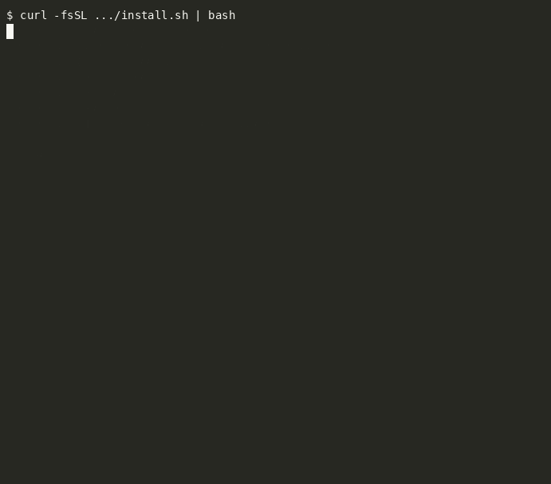

# harness

Single-command bootstrap for AI coding tools. One repo, one install, full environment reproducible on any linux machine in under 30 seconds.




## Numbers

| Metric | Count |
|--------|-------|
| Config templates | 80 |
| Managed files deployed | 52 |
| Hooks (Claude Code) | 35 |
| Hooks (Cursor events) | 9 |
| Skills (shared) | 19 |
| Plugins (Claude Code) | 10 |
| MCP servers | 5 |
| Modules | 9 |
| Template variables | 5 |
| No-op redeploy | <2s |

## Install

```bash
curl -fsSL https://raw.githubusercontent.com/anyesh/harness/main/install.sh | bash
```

First run clones the repo to `~/.harness`, detects installed tools, and deploys everything. Subsequent runs are idempotent (checksum-based skip).

### Lite install (no memory)

For a machine that should get the hooks, skills, commands and rules but neither second-brain nor the wiki (an interview laptop, say), pass `--no-memory`. Through the curl bootstrap the flag goes after `bash -s` and the double-hyphen separator:

```bash
curl -fsSL https://raw.githubusercontent.com/anyesh/harness/main/install.sh | bash -s -- --no-memory
```

`HARNESS_NO_MEMORY=1` does the same and also survives the bootstrap re-exec. A lite install skips the second-brain and wiki modules (no cargo build, daemon, sync timer or MCP registration), the memory hooks, the two memory rules, the `wiki` skill, the `devlog`, `plan` and `decision` commands and the `WIKI_VAULT` env entry. `--only second-brain` and `--only wiki` cannot be combined with it.

Lite mode is for machines that never had the full install. Switching from full to lite does not undo the earlier install: the second-brain systemd unit and sync timer, the `claude mcp add` entry in `~/.claude.json`, and the MCP entries in the Codex, Cursor and opencode configs stay until removed by hand, because `uninstall` only restores files the manifest tracks. Switching from lite to full just works.

## What gets deployed

### Claude Code

```
~/.claude/settings.json        ← permissions, hooks config, enabledMcpjsonServers
~/.claude/.mcp.json            ← MCP server definitions (cognitive-cache, web-strip, markitdown, second-brain)
~/.claude/CLAUDE.md            ← global instructions (exploration-first, TDD, scope gates, no AI comments)
~/.claude/hooks/               ← 35 hook scripts (see below)
~/.claude/skills/              ← 19 skill definitions
~/.claude/plugins/             ← 10 plugins from 2 marketplaces (claude-plugins-official, harness-mods)
~/.claude/harness-mods/        ← local folder marketplace holding the harness's own mods
~/.local/bin/claude-profile    ← one Claude Code profile per account (below)
```

#### Account profiles

`claude-profile` asks for a name and creates `~/.claude-<name>` plus a `claude-<name>` launcher that runs Claude with `CLAUDE_CONFIG_DIR` pointed at it, then offers `claude auth login`. Each profile signs in to its own account and keeps its own `.claude.json`, while settings, hooks, CLAUDE.md, skills, commands, plugins, mods and `projects/` (transcripts and auto-memory) are symlinks into `~/.claude`, so every profile runs the same harness and can resume the others' sessions. User-scope MCP servers are merged in from `~/.claude.json`.

`claude-profile list` shows each profile's account, `claude-profile remove <name>` deletes one (`remove --all` deletes every profile, and `install.sh uninstall` runs it, sign-ins included), and `claude-profile sync` relinks all of them; every install runs `sync`, so profiles pick up new entries and MCP servers. An install started from inside a profile session still targets `~/.claude`. If Claude replaces a shared symlink with its own file (a settings write, say), `sync` reports it instead of overwriting it.

### Cursor

```
~/.cursor/rules/*.mdc          ← 15 shared rules (alwaysApply)
~/.cursor/mcp.json             ← MCP servers (merged with existing; harness adds second-brain, cognitive-cache, web-strip, markitdown)
~/.cursor/hooks.json           ← 9 hook events (session, prompt, tool, shell, edit, stop, compact)
~/.cursor/hooks/               ← shared hook scripts (same family as Claude Code)
~/.cursor/skills/              ← shared skills (converge, humanize, ownit, wiki, terminal-gif)
~/.cursor/commands/            ← shared slash commands (plan, scope, commit, decision, devlog)
```

### Codex

```
~/.codex/config.toml           ← model, approval mode
~/.codex/instructions.md       ← shared instructions
~/.agents/skills/              ← shared skills (Codex reads user skills here)
```

### opencode

```
~/.config/opencode/AGENTS.md   ← shared global rules
~/.config/opencode/commands/   ← shared slash commands (plan, scope, commit, decision, devlog)
~/.agents/skills/              ← shared skills (opencode auto-scans this dir and ~/.claude/skills)
```

opencode.json(c) stays unmanaged (model/provider config is machine-specific); a
reference template lives at `configs/opencode/opencode.jsonc.tmpl`.

## Mods (Claude Code)

Mods are Claude Code plugins with an in-process hooks module (CLI 2.1.287+). The harness keeps them in `configs/claude-code/mods/`, a folder marketplace named `harness-mods`. `install.sh` copies it to `~/.claude/harness-mods/` (tests excluded), registers and installs each mod, and `settings.json.tmpl` carries the matching `extraKnownMarketplaces` and `enabledPlugins` entries so a redeploy never drops them. Claude Code reads an installed mod straight from that folder, so after a redeploy `/reload-plugins` picks up the change.

| Mod | What it does |
|-----|--------------|
| `nudge-band` | Band above the prompt showing scope (`.scope.md` missing or stale), wiki (devlog and index not written this session) and untracked junk, with buttons that pre-fill `/scope`, `/devlog` or a cleanup prompt. Claude gets one reminder when a condition first holds; the wiki reminder repeats after 3 more edits or 10 more turns without a wiki write. Active humanize and ownit modes show in the footer beside Claude Code's own modes. |
| `cache-guard` | Tracks when the main thread last got a response and whether each turn's first request found the prompt cache warm or cold, learning the cache lifetime from those hits and misses (60 minutes until it has seen one). The status line ends with `cache 42m`, or `cache cold ≈ $3.04` in yellow once the next send would re-write the context. The status line and the gate both read the context size live from `$.session.usage()`, so neither shows right after a compaction or `/clear`. When an idle composer prompt would re-write at least `gateUsd` (default $1) of context, it asks whether to send anyway, clear and hand off, or keep the prompt as a draft, and a dismissed or unanswerable question sends. Clear and hand off runs `/clear` (the SessionStart hook then points the fresh session at the handoff digest) and puts the prompt back in the box under a line asking to continue from that digest, so nothing large is re-written. A cold turn that re-wrote 50k tokens or more raises a toast with its estimated cost at API prices. Subagent steps are tracked the same way against their own learnt TTL (`agentTtlMinutes`, default 5): the status line adds `agents 3` (or `agents 3 · 1 cold` in yellow) while `$.agent.list()` shows live agents, a cold resumed agent raises its own toast, and the band above the prompt lists up to three agents that sit idle past the TTL with 50k tokens or more, or have run over an hour, each with a Dismiss button. Ended subagents leave the list within a minute, so their records age out after a day instead. |
| `guard-watch` | Watches `tool.check` verdicts and counts every call a settings `PreToolUse` guard denied, naming the guard from its message (`[hook:cost-guard]`, `BLOCKED by pre-bash-guard`, or the hook script's path). The status line shows `2 blocks`, in yellow once a subagent was blocked, and a subagent's block raises a toast (`cost-guard blocked Explore's Read: ...`) because it never reaches the main transcript. It only observes: the verdict passes through unchanged. |
| `context-audit` | `/context-audit` prints what `/context` does not: MCP tokens per server (loaded and deferred), skills grouped by plugin or source, memory files, agent definitions and slash commands, each sorted by tokens, then up to five trim candidates (an MCP server over 5k loaded tokens, a skill over 1k, a memory file over 3k) with their share of the window. It reads `$.session.usage({ breakdown: 'summary' })` on demand and runs nothing otherwise. |
| `handoff` | Answers main-thread compaction (`auto`, `/compact`, and a plugin's such as cache-guard's "Compact first") with one handoff message instead of the built-in summary: `handoff-digest.sh` supplies the facts (files touched, repo state, last plan, newest turns) and a tool-less `$.model.fork` writes goal, next step, decisions, ruled-out paths, open questions and the verify command. Each handoff is saved as `${XDG_STATE_HOME:-~/.local/state}/harness/handoffs/<slug>/<session>.handoff-<n>.md`, outside every profile's config dir, so all profiles share them without a symlink. A failed fork keeps the built-in summary with the digest appended; a failed digest asks the built-in summarizer to cover the reasoning sections. `/compact classic [text]` gets the built-in summary, and subagent compactions are left alone. |

Develop a mod with `claude --plugin-dir configs/claude-code/mods/<mod>` (hot reload), and check it with `claude plugin validate --strict <dir>` and `claude plugin test <dir>`; `tests/test_harness_mods.sh` runs both for every mod. A mod must not register a Bash `tool.call` hook while anthropics/claude-code#92533 is open, because that breaks worktree-isolated subagents.

A mod cannot draw on the status line itself, so a mod with something to show there writes `{ "text", "tone", "at" }` to `${XDG_STATE_HOME:-~/.local/state}/harness/status/<session id>/<mod>.json` and removes it when the session ends. `statusline.sh` appends each segment in a fixed order, draws `warn` in yellow, and skips a file older than 10 minutes.

## Hooks

| Hook | Trigger | Purpose |
|------|---------|---------|
| `pre-edit-comment-guard.py` | PreToolUse (Write/Edit) | Blocks AI-generated narration comments |
| `pre-edit-code-quality.sh` | PreToolUse (Write/Edit) | Rejects shortcut-seeking language |
| `stop-sloppiness-guard.sh` | PostResponse | Detects lazy patterns, injects correction |
| `cost-guard.sh` | PreToolUse (Bash) | Blocks unbounded output in main context |
| `context-cold-start-guard.sh` | beforeSubmitPrompt / preCompact (Cursor) | Blocks cold re-bill on large context after model change, compaction, or cache idle |
| `pre-bash-guard.sh` | PreToolUse (Bash) | Validates commands before execution |
| `format-on-save.sh` | PostToolUse (Write/Edit) | Auto-formats written files |
| `post-compact-context.sh` | SessionStart `compact` (Claude Code, Codex) / preCompact + postToolUse (Cursor) | Re-injects the active `.scope.md` after compaction |
| `compact-note.sh` | Called by `post-compact-context.sh` and the opencode `harness-compact-scope.js` plugin | Renders `.scope.md` within the injection cap |
| `session-start.sh` | SessionStart | Activates modes, checks environment |
| `session-end-ingest.sh` | SessionEnd | Ingests session into second-brain (machine memory) |
| `session-start-wiki.sh` | SessionStart | Injects project wiki context + devlog |
| `session-start-handoff.sh` | SessionStart (Claude Code) | After `/clear`, digests the previous session (pointer left by `session-end-handoff.sh`); on startup, resume, or a clear without a pointer, names the project's handoff dir and its three newest files |
| `worktree-sweep.sh` | SessionStart (Claude Code, async, logs to `~/.local/state/harness/worktree-sweep.log`) | Removes idle worktrees whose commits landed on main, salvaging uncommitted files to `.git/worktree-salvage/`; Codex and Cursor have no async session start, so run it by hand |
| `humanize-*.js` | Various | Humanize mode activation, config |
| `ownit-*.js` | Various | Ownership mindset activation, config |
| `attention-notify.sh` | Notification, PreToolUse `AskUserQuestion\|ExitPlanMode`, prompt, tool and session-end events (Claude Code); PermissionRequest, Stop and the same cancel events (Codex); stop, prompt, tool and session-end (Cursor) | Pushes to ntfy when a session waits on you or finishes (see below) |
| `attention-core.sh` | Called by `attention-notify.sh` and the opencode `harness-attention.js` plugin | Arms, cancels and sends the ntfy push |

On Claude Code the scope, wiki and hygiene nudges (`scope-drift-detector.sh`, `wiki-nudge.sh`, `cleanup-nudge.sh`) are replaced by the `nudge-band` mod below; Cursor and Codex keep the shell scripts.

Guards match on the code a command runs, not on quoted text or heredoc bodies (`shell-code.sh`), and every block is appended to `~/.local/state/harness/hook-blocks.jsonl` (`log-block.sh`; override with `HARNESS_BLOCK_LOG`). Two scripts keep false positives visible:

- `scripts/hook-blocks.sh [--days N]` summarises recent blocks per hook.
- `scripts/guard-replay.sh [--transcripts N] [--hook NAME]` replays real tool calls from Claude Code transcripts through the repo's current guards and lists what each would block. Run it before shipping a guard change and read every sample.

### Phone push when a session needs you

Set `NTFY_URL` (your ntfy server) and `NTFY_TOPIC` in the environment or `~/.harness.env`, plus `NTFY_TOKEN` if the topic needs a bearer token. Nothing is sent until both the URL and topic are set, so there is no fallback to the public ntfy.sh. A session that blocks on you (a question, plan approval or permission prompt) pushes at priority 4 after `NTFY_BLOCK_DELAY` seconds (default 60, so a block you answer at the desk within a minute never reaches the phone). Finished-turn pushes are off unless `NTFY_DONE=1`; with it set, a finished turn pushes at priority 3 after `NTFY_DONE_DELAY` (default 60; Claude Code's own idle notice already waits a minute, so it adds nothing there). Answering, pressing Esc or typing a prompt inside that window cancels the push, and a session that has exited stays quiet.

Headless `claude -p` never pushes; set `HARNESS_NOTIFY=0` for `codex exec`, `opencode run` or other scripted runs. Cursor only gets finished turns because it has no hook for approvals or agent questions, so it stays silent unless `NTFY_DONE=1`. Codex asks you to trust new hook entries through `/hooks` after a redeploy. Every arm, cancel, send and skip is logged with its reason to `~/.local/state/harness/attention/log` (last 200 lines).

## MCP Servers

| Server | Transport | Purpose |
|--------|-----------|---------|
| `second-brain` | stdio | Personal knowledge graph (KùzuDB, BGE embeddings, 384-dim) |
| `cognitive-cache` | stdio | Optimal file selection for LLM context |
| `web-strip` | stdio | Clean markdown extraction from URLs (Readability) |
| `markitdown` | stdio | PDF/DOCX/XLSX → markdown |
| `verdant` | stdio | Cross-session tool call caching (per-project) |

## Skills

| Category | Skills |
|----------|--------|
| SEO | `seo`, `seo-audit`, `seo-page`, `seo-plan`, `seo-technical`, `seo-schema`, `seo-sitemap`, `seo-content`, `seo-images`, `seo-hreflang`, `seo-geo`, `seo-competitor-pages`, `seo-programmatic` |
| Knowledge | `wiki` (Karpathy-pattern LLM wiki) |
| Workflow | `terminal-gif`, `humanize`, `ownit` |

## Modules

```
claude        Claude Code: configs, plugins, hooks, skills, MCP
cursor        Cursor: rules, mcp.json, hooks.json, skills, commands
codex         Codex: config.toml, instructions
opencode      opencode: AGENTS.md, commands, skills via ~/.agents/skills
second-brain  second-brain daemon + MCP server registration
wiki          Obsidian wiki vault init (Karpathy pattern, per-project)
watch         File watcher for auto-ingest
leakguard     gitleaks + global pre-commit scan for personal info/secrets;
              pairs with the publish-leak-guard Claude hook that scans built
              artifacts (sdists/wheels) before uv publish/twine upload.
              Escape hatches: '#gitleaks:allow' inline, LEAKGUARD_SKIP=1.
              Caveat: repos that set their own core.hooksPath (like this
              one) bypass the global scan; they must scan themselves.
lib           Shared functions (logging, template rendering, manifest)
```

## Wiki (Knowledge Base)

The harness deploys an LLM-maintained wiki based on Andrej Karpathy's [LLM Wiki](https://gist.github.com/karpathy/442a6bf555914893e9891c11519de94f) pattern. The LLM builds and maintains structured Obsidian pages as you work; you never write the wiki yourself.

**Setup:** Set `WIKI_VAULT` in `~/.harness.env` to your Obsidian vault path. The wiki module creates the structure on install.

**How it works:**
- Every session, the LLM sees wiki context (project devlog, index) via session-start hook
- CLAUDE.md instructs the LLM to proactively write wiki pages when plans, decisions, spikes, or concepts emerge
- Pages are organized per-project: `wiki/projects/<slug>/` with devlog, decisions/, plans/, spikes/
- Pre-compact hook reminds the LLM to capture anything valuable before context compression
- `/wiki` skill provides full operations: ingest external sources, query, lint

**What gets captured:** plans, PRDs, architecture decisions (ADRs), exploration spikes, concepts, devlogs. Not captured: routine fixes, debugging transcripts, AI bloat.

**Vault structure:**
```
$WIKI_VAULT/
├── wiki/
│   ├── projects/<slug>/    ← per-project knowledge
│   ├── concepts/           ← cross-project concepts
│   ├── synthesis/          ← filed query answers
│   ├── sources/            ← external source summaries
│   ├── index.md            ← master catalog
│   └── log.md             ← activity timeline
├── raw/                    ← immutable source copies
└── WIKI_SCHEMA.md          ← conventions
```

## Template Variables

Set in `~/.harness.env`:

```bash
USER_EMAIL=you@example.com
GITHUB_USER=yourhandle
DATA_ROOT=/path/to/data
MCP_COGNITIVE_CACHE_PATH=cognitive-cache-mcp
HOME_DIR=/home/youruser
```

## Commands

```bash
./install.sh                    # Full deploy (default)
./install.sh --only claude      # Single module
./install.sh --force            # Redeploy even if unchanged
./install.sh --dry-run          # Preview without changes
./install.sh --no-memory        # Skip second-brain and the wiki
./install.sh --override-settings  # Replace ~/.claude/settings.json instead of merging into it
./install.sh status             # Show managed file state
./install.sh uninstall          # Restore all backups
```

## Architecture

```
~/.harness.env                  ← Personal variables (not committed)
~/.harness-manifest.json        ← Deployed file checksums (auto-generated)
harness/
├── configs/
│   ├── claude-code/            ← Templates: settings, CLAUDE.md, .mcp.json, hooks, skills
│   ├── cursor/                 ← Templates: rules, mcp.json
│   ├── codex/                  ← Templates: config.toml, instructions
│   └── opencode/               ← Templates: AGENTS.md, opencode.jsonc (reference)
├── modules/                    ← Deploy logic per tool (claude.sh, cursor.sh, etc.)
├── lib/                        ← Shared: template rendering, manifest, backup, detect
├── tools/                      ← Bundled tools (web-strip)
└── install.sh                  ← Entrypoint
```

## Deploy Flow

1. `install.sh` sources all libs and modules
2. Detects installed tools via PATH and config dirs
3. Reads `~/.harness.env` for template variables
4. Per module: renders templates → checksums → skips if unchanged → backs up → deploys
5. Removes orphans, deployed files whose `configs/` source was renamed or deleted: an unchanged copy the harness created is deleted along with any folder it leaves empty, one that replaced a file you had is swapped back to your original, and an edited copy or one with no pre-existence record stays in place for `status` to flag
6. Writes `~/.harness-manifest.json` with file hashes
7. Idempotent: re-run anytime, only changed files get touched

## New Machine Setup

```bash
# 1. Install
curl -fsSL https://raw.githubusercontent.com/anyesh/harness/main/install.sh | bash

# 2. Configure
cat > ~/.harness.env << 'VARS'
USER_EMAIL=you@example.com
GITHUB_USER=yourhandle
DATA_ROOT=/path/to/data
HOME_DIR=$HOME
VARS

# 3. Deploy
~/.harness/install.sh

# 4. Verify
claude mcp list    # Should show 5 servers connected
```

## Requirements

- bash 4+
- git
- jq
- perl (template rendering)
- `claude` CLI (for plugin/MCP registration; configs deploy without it)
- Node.js (for web-strip)
- Python 3.9+ with `uv`/`uvx` (for cognitive-cache, markitdown)
